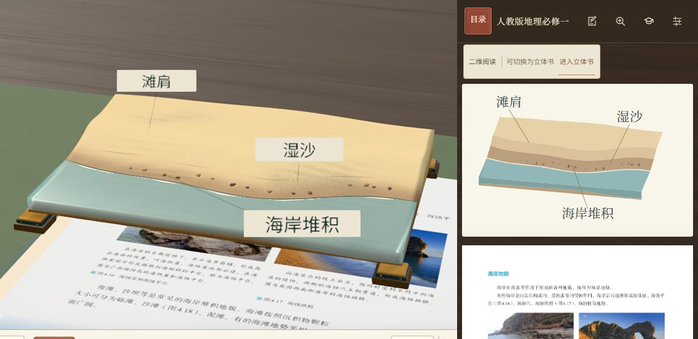

# 海滩双次冲洗

生产入口 index-BExZcQh1.js。两次上冲之间有回洗；十五颗示意颗粒的起点、携带距离、长短轴和朝向可逐颗追踪。两种显示共用位置和时序。移动端保留简化剖面，桌面沙面有固定在地形上的细粒与斑状波痕。

生产构建在默认 2× 下实际播放，复核了开始、第一次上冲、第一次回洗、第二次上冲和最后停留的位置。海岸四条件采样 60 个状态无浏览器报错，整册手机模拟通过 2702 项检查。新增测试覆盖第一次回洗、第二次搬运和最终停留，合计 599 项单测通过。
