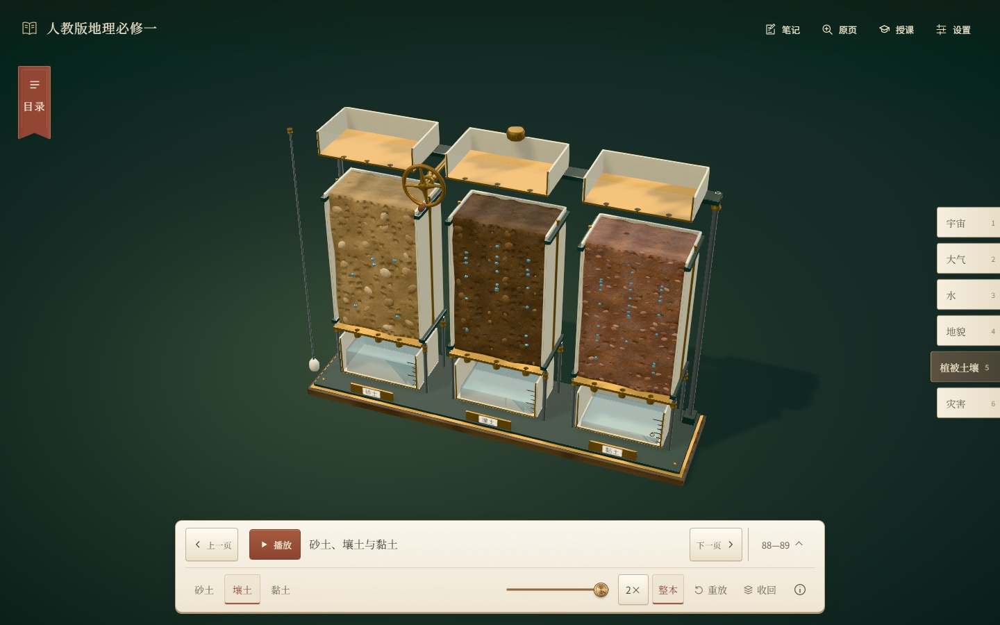
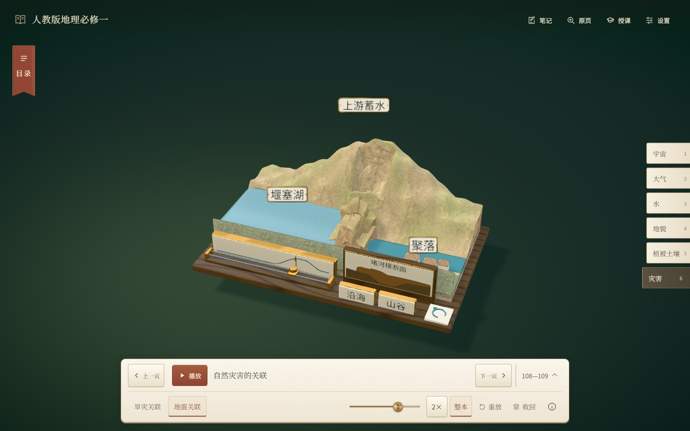
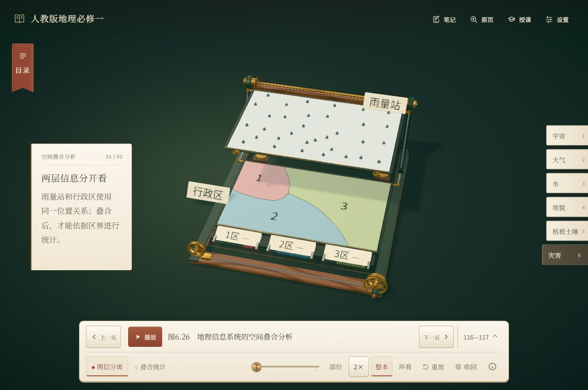
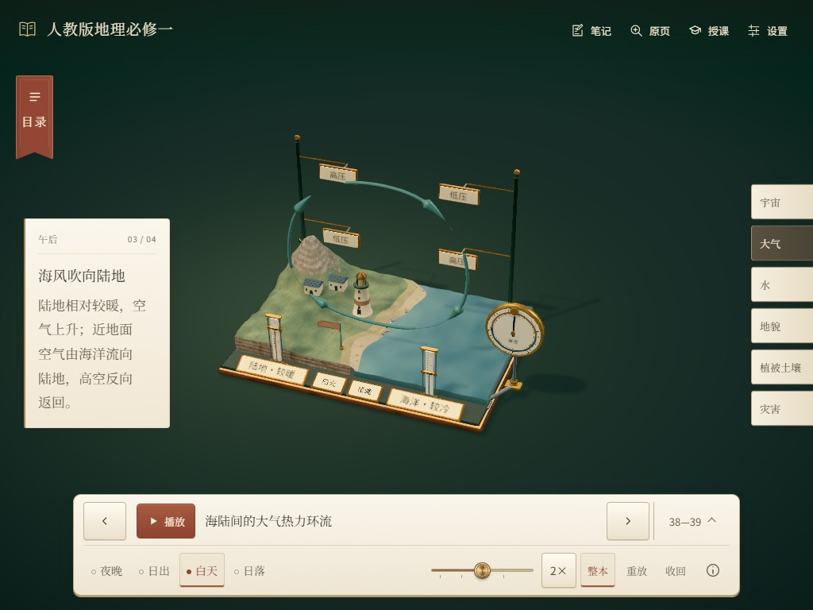

# 十二件可操作的地理教具

正式网页入口为 `assets/index-BHGWvChl.js`，SHA256 为 `39bcf296d95e98bec38561b9d3ab3b922125ae6a85a2707af0de57767b4e836b`。

| 课题 | 可在仪器上完成的观察 |
| --- | --- |
| 地球生命条件、太阳辐射空间分布 | 用三档旋钮在同一颗地球上观察温度、液态水与大气。另一台用齿条升降光源，让相同截面的光束从赤道移到北纬 65°，比较球面照射范围。两页共用 Natural Earth 海岸线。 |
| 海陆风、寒潮 | 转动昼夜盘比较海陆两侧同高度的气压。推动冷锋游标经过麦田和测站，麦苗依次倾斜，风旗与冷热读数随锋面位置改变。 |
| 地貌观察 | 测针沿一座带裸岩、山脊和沟谷的实物地形取样。四个键可在同一位置比较绝对高度、相对高度、坡度和坡向。高度来自用于显示坡面的三角网。 |
| 森林分层、植被与环境 | 让测光架经过乔木、灌木和草本的不同高度。腊叶柜可换七类植被，还能近看雨林藤本和板根、转动季节盘观察季相。 |
| 土壤质地、土壤水盐养护 | 用黄铜阀给砂土、壤土和黏土同时供水，比较孔壁、湿润锋及杯内出水。在水盐剖面观察含水砾层、地表盐壳与排盐收集杯的变化。 |
| 滑坡与泥石流、灾害链 | 拖动地景观察尺，比较源区和坡脚的物质。灾害链的山谷分支用同一组十二块石土形成堵江、蓄水和溃口。回拖可沿同一路径返回。 |
| GIS 空间叠合 | 正反摇动绞轮或推动滑柄，先把两张地图对位，再分区计数。教材图上的 33 个站点由几何归属判别，三串计数珠分别移出 5、15 和 13 颗。 |

## 土地材质

四种随书离线分发的实物扫描保存土岩表面的明度、起伏与粗糙度，也保存了原照片相对本底的冷暖变化。讲解中的不同土层仍有各自的基色。地貌测针、滑体、土柱和盐壳另有各自的实体几何。[扫描来源](../../../public/textbook/materials/SOURCES.md)

## 复核范围

正式入口通过类型检查、615 项单元测试和 11 项端到端测试。此前一版集成预览在 1024×768 下走过本批十二景的 104 个条件、进度和节点状态。最后修改的地貌观察、GIS 在下一候选补测了 17 个状态。随后仅微调地貌平面图的色阶。各组另做本体正反操作、条件切换和停止检查。触摸采用浏览器设备模拟。

Blender 总装重开核对六章 63 景及 5820 个网格，十二个变更场景重新渲染图录。核验内嵌四通道扫描及冷暖通道进入着色节点的连接。另可打开海岬测风台、冷锋测站、森林测光架和七类植被腊叶柜四份单件母版。

浏览器证据保存于工作区 `work/gis-M0nDrvGJ/`、`work/tablet-branches-M0nDrvGJ/`、`work/tablet-branches-BlWYBvfW/`、`work/soil-hydrology-review/`、`work/weather-observers-review/`、`work/botanical-review/`、`work/globe-instrument-review/` 以及 `work/manual-coverage/gestures/` 中各仪器的子目录。博物馆实物感仍由读者依据教材实景判断。

