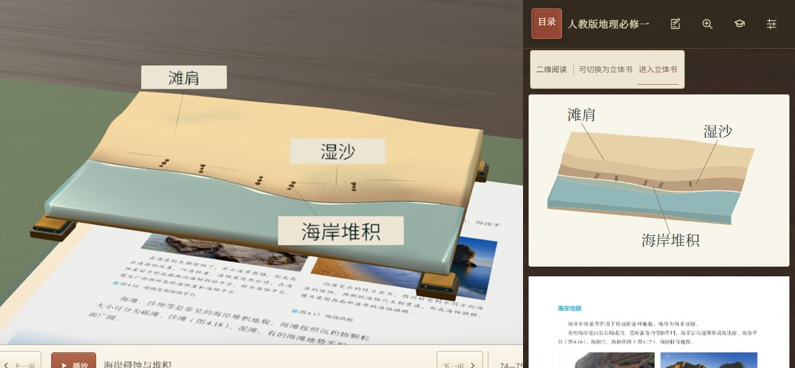

# 海滩堆积

生产入口 index-BbTiggMp.js。选择“海滩堆积”后单独展开滨岸剖面。滩肩、湿沙、冲洗前缘和海床共用同一高程函数。十五颗示意颗粒从水下移向岸上并留在滩面。浅水剖面在切边处接入海床。选择其余三个海岸条件仍打开对应的侵蚀演示。

实际以默认 2× 播放到进度超过 42%，暂停并拖至 96% 拍摄桌面画面。桌面海岸四条件 60 个状态采样、整册手机模拟 2702 项检查和 598 项单测通过。实物教室投影与整册审美认可待验证。
