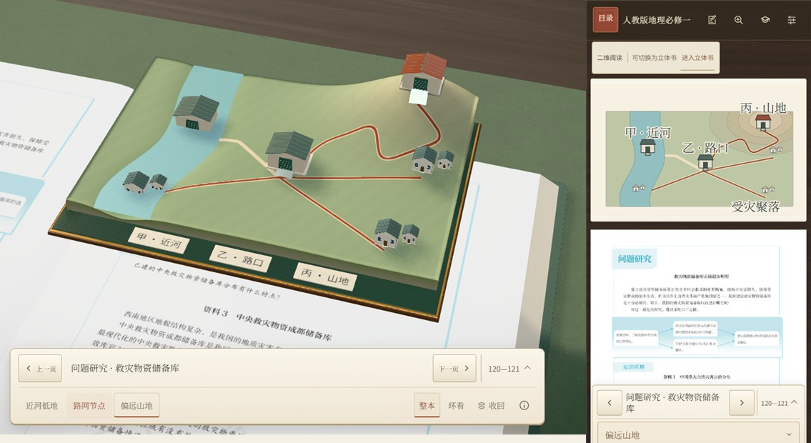

# 救灾物资储备库

生产入口 index-Bv0nsJTQ.js。三个库址共用一张地图和固定高水位。赭红屋顶对应当前选中的库房，同色路线从装卸口接入村道。水面遮住低地受淹的路段。山路的弯道、入网位置和聚落终点在两种视图中来自同一组坐标。屋面补上折边与脊线，两端山墙封闭。

桌面逐项切换了三个库址并收回、重新展开。手机模拟遍历整册 63 个入口，2702 项检查通过。598 项单元测试通过。图为同版浏览器截图裁切拼合。教室设备和整册审美定稿待验证。
