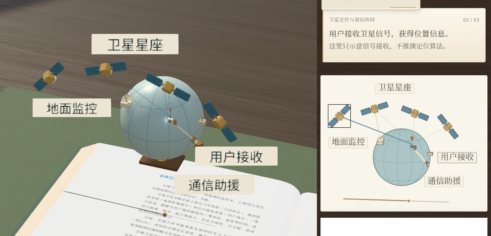

# 全球卫星导航系统与救援

生产入口 index-CG3kddnm.js。卫星带有切角机舱、共轴双翼和朝地天线，二维从同一组顶点投影。地面站的三根支杆在抛物面焦点会合，馈源位于既有监控链路的接收点。球仪底部有木座和黄铜承轴。三维链路随进度伸长，选中卫星时可只看这颗星与用户的联系。

桌面三个条件共取样 39 个状态。单星观察已分别通过三维实体点击和手机二维键盘操作核验。截图左右取自不同阶段。598 项单测与整册手机模拟 2702 项检查通过。课堂投影上的信号线辨识度仍待实机确认。
