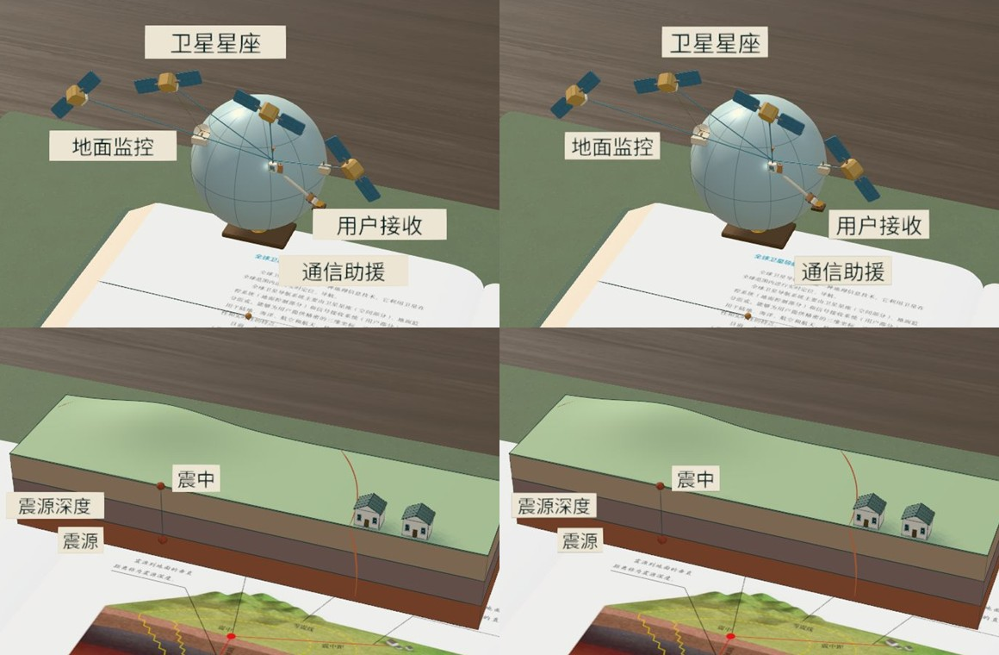

# 整册模型标牌复核

普通纸签按文字宽度留边，共用同一套字面比例。潮汐、地震与灾害关联页会在字幕更新时重绘纸签。卫星导航页四张纸签的可见宽度从各自标牌平面的 100% 降至 75%，字高比例保持 0.69。近景纹理尺寸按纸签长宽比设置上限；这四张纸签的纹理合计从 1,598,856 像素降至 625,152 像素。

生产入口 index-CwCapNYC.js。全册 63 个桌面入口各有一张运行截图，手机模拟检查 2702 项。潮汐、地震、灾害关联和卫星导航专项分别采样 36、39、18 和 39 个状态，未记录浏览器错误。

[整册图版一](全册-1.jpg) · [整册图版二](全册-2.jpg) · [整册图版三](全册-3.jpg)

图版呈现每页一个条件和进度。溶洞在整页视角下洞内层次较弱，台风云墙的几何折面较突出，震后综合推演的卫星与地面节点仍显小。整册各条件的近景、课堂投影和最终审美验收仍待完成。
