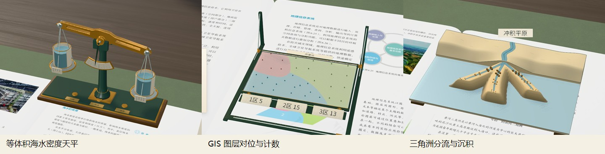

# 整册画面复核

版本 index-Cy-6TJTk.js。下表按实际目录排序。桌面图版来自 1440 × 960 的整页截屏裁切，连续进度取 72%，静态课取打开状态。手机使用 390 × 844 的 Edge 模拟视口，表中的帧数包含条件、时间点和公开节点。

本次逐图记录可辨认的主体和仍薄弱的部位。逐场景的构思沿用重构清单；同一页的形成态、所有近景、实物平板和教室投影仍需分别验收。

| 图版 | 演示 | 教学构思 | 桌面画面观察 | 手机采样帧 |
|---|---|---|---|---:|
| [图版 1](整册图版-1.jpg) | 天体系统的层次 | 四级常驻标本的所属联系与主体体积；连接退后，示意尺度明确 | 长轴已串起层级，远端星群在全景较细。 | 12 |
| [图版 1](整册图版-1.jpg) | 图1.4　太阳系结构 | 行星与细轨道在同一轮系承托，手轮连同一进度；不伪装真实比例周期 | 轨道叠层清楚，内侧行星需要近看。 | 3 |
| [图版 1](整册图版-1.jpg) | 地球存在生命的条件 | 一颗可见陆海的地球，温度/水/气共存；薄大气不遮陆，不模拟造生命 | 子午圈沿球面包合，陆海轮廓在正面可辨。 | 9 |
| [图版 1](整册图版-1.jpg) | 太阳辐射的纬度差异 | 同束光入射真实曲面，光斑贴球；光阑和观察纬度共轴 | 平行光束与球面接触点可见，入射线在浅页上偏细。 | 6 |
| [图版 1](整册图版-1.jpg) | 图1.14　家庭太阳能供热系统 | 集热器—水路—储水—室内接收闭合，房屋剖面避开观察线 | 屋顶集热板和屋内管路能顺着看，楼层内的小字依赖近景。 | 7 |
| [图版 1](整册图版-1.jpg) | 太阳活动与地球 | 日地传播路径与极区接收，扰动有到达次序，不直喷地面 | 太阳和地球都有清楚轮廓，两者间的作用过程在此帧偏弱。 | 6 |
| [图版 1](整册图版-1.jpg) | 图1.23　A、B两地地层对比 | 两柱连续自然断面、六层九化石对应，外导向避开连线与抽样 | 两座地层的层界清楚，化石表面仍显平。 | 6 |
| [图版 1](整册图版-1.jpg) | 地质年代与生命演化 | 铰轴标本册的页厚/断口/代表生物；四时期不冒充等时长 | 标本沿时间顺序展开，相邻标本之间留白充分。 | 12 |
| [图版 1](整册图版-1.jpg) | 地震波如何穿过不同介质 | P/S联接与介质共轴，追踪同一质点，液体无S传播 | 两排传播介质可辨，细线与后景教材对比偏低。 | 6 |
| [图版 1](整册图版-1.jpg) | 图1.34　地球内部地震波传播速度与圈层结构 | 闭合球壳的真实切面与抽层路径，极轴承托，核层独立可见 | 剖面和圈层名称同屏，内外半径关系容易辨认。 | 12 |
| [图版 1](整册图版-1.jpg) | 地球外部圈层的联系 | 同一岩土/水/植物/空气环境，跨圈层迁移留在实际接收端 | 四圈层压缩在同一剖面，连线和水面交汇处偏细。 | 9 |
| [图版 1](整册图版-1.jpg) | 问题研究 · 火星基地 | 统一厚壳剖开舱段、舱内设备与接头，取消整块矩形板主导；四回路边界保留 | 四舱有统一朝向，白色舱盖面积仍压过部分内部设备。 | 12 |
| [图版 2](整册图版-2.jpg) | 大气的组成 | 开放百格体积分数立体教具，局部展开仍保留整体分母 | 成分格盘在全景能认出，右侧细长框的作用主要靠近看。 | 6 |
| [图版 2](整册图版-2.jpg) | 图2.5　大气的垂直分层 | 开放垂直剖面与同源曲线探针，去玻璃砖，固定高度与观察焦点 | 分层曲线连续，但顶端标题与横梁过近。 | 6 |
| [图版 2](整册图版-2.jpg) | 图2.9　大气的受热过程 | 短波—地表—长波—吸收分离但相接，接收体随实际到达响应 | 长短波方向可循，底层与支撑的颜色接近。 | 7 |
| [图版 2](整册图版-2.jpg) | 大气的保温作用 | 同地表三条件对照，低云/大气为开放层，不成密封玻璃盖 | 地面、路径和标题之间留白较大，细线在浅色背景偏弱。 | 9 |
| [图版 2](整册图版-2.jpg) | 图2.11　大气热力环流的形成 | 冷热标本与同高梁一体，垂直/水平闭环；控制接入同一机构 | 上下指针与三个地面分区对应，指针细刻度只在近看可辨。 | 8 |
| [图版 2](整册图版-2.jpg) | 海陆间的大气热力环流 | 海岸水下切面、风旗和日月柄整体，临界弱风与反向同源 | 海岸和气流回路同屏，上方回路在木纹上偏淡。 | 7 |
| [图版 2](整册图版-2.jpg) | 大气的水平运动——风 | 同高比较面与指示器共梁，差压输入对应风旗，零差压边界准确 | 两端气压指针清楚，平面流向线偏细。 | 6 |
| [图版 2](整册图版-2.jpg) | 等压线与风向 | 薄地图等压线与风/力向量，四条件独立比较，不强加时间演化 | 高低压位置可辨，承载区与教材纸页色值接近。 | 12 |
| [图版 2](整册图版-2.jpg) | 问题研究 · 何时蓝天常在 | 同城市排放—输送—滞留—迁出，污染存量不因减排瞬间清零 | 排放源与街区可辨，远处颗粒容易融入桌面。 | 9 |
| [图版 2](整册图版-2.jpg) | 综合观察　流域里的水与沙 | 山地—河口共流域地形；本次水路与长期沉积不同时间尺度 | 上下游剖面和水沙层分明，近侧断面有遮挡。 | 27 |
| [图版 2](整册图版-2.jpg) | 图3.2　水循环示意 | 山海地下水连续切块，六示踪跨状态同身份，三循环独立 | 山地至海洋高差清楚，地表与地下两条注记较近。 | 23 |
| [图版 2](整册图版-2.jpg) | 水体更新与水资源短缺 | 同储水体可见补给/取用/污染口，数量与可用性分开 | 大水槽和接收杯形成明确的水量对照。 | 9 |
| [图版 3](整册图版-3.jpg) | 图3.8　海水温度随深度的变化 | 开放深水剖面、切片与探针同曲线，不将观测深度画成水位 | 深度与温度的两个轴可读，浅色温度曲线需要近看。 | 6 |
| [图版 3](整册图版-3.jpg) | 哪些条件影响海水盐度 | 开口槽与三输入/固定盐示踪/水位共状态，蒸发不带盐 | 同一槽体和水位可辨，透明侧壁与水体色差较小。 | 18 |
| [图版 3](整册图版-3.jpg) | 海水密度的条件对照 | 等体积样本的质量比较，轴承/悬杯/指示同机构；不暗改体积 | 两盘和扇面关系清楚，细分度需放大观察。 | 9 |
| [图版 3](整册图版-3.jpg) | 图3.20　波浪要素示意 | 水槽剖面与表面波一体，同质点闭合往复，不随波峰迁走 | 连续波峰在全景最易辨认，水质点在剖面上较小。 | 6 |
| [图版 3](整册图版-3.jpg) | 图3.22—3.23　潮汐与人类活动 | 岸滩/水下地形/水位杆/浮舟同高度，潮间带可见 | 岸线、潮间带和固定标尺同屏，细刻度依赖近看。 | 7 |
| [图版 3](整册图版-3.jpg) | 图3.26　海水运动 | 十二水体身份净迁移与原位往复参照，保留首末位置 | 参照点和浮标可比较，标注引线在水面上较淡。 | 6 |
| [图版 3](整册图版-3.jpg) | 问题研究 · 海冰淡化 | 冰体真盐水通道、有限收集端与离心同轴，残余盐水可见 | 盐水收集槽可认，收集的盐粒需要特写。 | 6 |
| [图版 3](整册图版-3.jpg) | 图4.2　地表喀斯特地貌演变 | 有闭合侧面与裂隙的可溶岩体，六形态独立，水进入真实表面 | 溶沟通过光影可读，岩面层理主要显在切边。 | 18 |
| [图版 3](整册图版-3.jpg) | 地下喀斯特地貌 | 剖壳后的真洞腔，顶底沉积与滴水接触，观察侧可开合 | 洞腔和洞顶有纵深，初始态的内部对比弱。 | 6 |
| [图版 3](整册图版-3.jpg) | 河流地貌与河谷 | 山地/平原两类自然河谷与河床连续，可比取景，非强制演化 | 河谷展宽的剖面清楚，底部注记靠近书页文字。 | 6 |
| [图版 3](整册图版-3.jpg) | 图4.8　河曲和牛轭湖 | 同岸线/水/流路冲颈、接通、两端淤塞，牛轭湖结果保留 | 曲流、裁弯处和旧河道轮廓清楚。 | 6 |
| [图版 3](整册图版-3.jpg) | 冲积平原与河口三角洲 | 水下基底与不对称分汊连通，有限泥沙落点改变沉积与岸线 | 三条沉积舌和分流河道独立可辨，河口坡面仍显陡直。 | 9 |
| [图版 4](整册图版-4.jpg) | 风沙地貌 | 风蚀岩、雅丹、沙丘与固沙分别造型，迎背风和堆积落点成立 | 风蚀蘑菇轮廓清楚，受蚀侧与背风侧色差偏小。 | 12 |
| [图版 4](整册图版-4.jpg) | 海岸侵蚀与堆积 | 岩壁真凹槽/平台/崩落体，拱桥柱滩分支独立，崩落不消失 | 海蚀崖与平台分层可见，崖体外形较方正。 | 16 |
| [图版 4](整册图版-4.jpg) | 图4.22　黄土高原某地等高线地形 | 同网格等高线连续抬升，甲乙点贴地；879.0/885.4/6.4关系保留 | 两个峰顶与等高线对应，低坡的线较淡。 | 6 |
| [图版 4](整册图版-4.jpg) | 地貌观察：高度、坡度与坡向 | 同地形的高程基准/坡尺/方向，四观察量不改自然对象 | 主峰与海平面可辨，坡向需要切换条件后观察。 | 12 |
| [图版 4](整册图版-4.jpg) | 问题研究 · 喀斯特峰丛山地 | 峰丛薄土/地下通道/农业接触，雨涝晴旱与水土去向可追踪 | 峰丛和洼地连续，树木的树冠剪影仍简单。 | 12 |
| [图版 4](整册图版-4.jpg) | 图5.2　森林中的成层现象 | 冠干灌草根土共一片标本，观察面滑移不删除其他层 | 乔灌草垂直结构完整，乔木冠层仍偏圆团。 | 6 |
| [图版 4](整册图版-4.jpg) | 植被与环境的适应 | 七类枝冠根叶轮廓分别构建，林下有层次，低矮植被独立取景 | 雨林叶簇层次可辨，树下板根宜看近景。 | 21 |
| [图版 4](整册图版-4.jpg) | 土壤的四种组成 | 真实团聚体和互补孔隙，水气在同空间替换，去悬浮分项 | 孔隙在土粒间可见，前排颗粒较遮后排。 | 9 |
| [图版 4](整册图版-4.jpg) | 砂土、壤土与黏土 | 三柱统一入水与独立接收，颗粒/水保身份，质地差异可见 | 三组对照柱直观，最细颗粒在全景收为纹理。 | 9 |
| [图版 4](整册图版-4.jpg) | 图5.17　森林土壤剖面及各土层特点 | 六层自然连续断面与低位夹持，抽层/标签/24物质同向且有留存 | 不同土层和剖面边缘清楚，窄土柱侧方留白较多。 | 49 |
| [图版 4](整册图版-4.jpg) | 土壤形成的因素 | 岩土断口、根孔/枯落物与风化接触；0—3与分选4分别验 | 母质、表土和幼苗有上下对应，表土边界较整齐。 | 15 |
| [图版 4](整册图版-4.jpg) | 土壤水盐运动与养护 | 地下水/毛管/土面/排水口连续，返盐淋盐抑蒸各有去向 | 剖面和水分运动方向可辨，土层细纹需要近看。 | 18 |
| [图版 5](整册图版-5.jpg) | 综合实验　一场雨进入城市 | 同街区可开地下剖面，有限雨水分配守恒，三条件相同布局 | 建筑、路面和管道共用剖面，地表设施较小。 | 24 |
| [图版 5](整册图版-5.jpg) | 问题研究 · 城市不再看海 | 同街区三地面与有限雨水，下渗暂存排出接收区可见 | 地表积水与地下管道同屏，前后标注容易贴近。 | 24 |
| [图版 5](整册图版-5.jpg) | 洪涝与低地积水 | 同河床低地建筑水位，积水随实际地形接触，不整片蓝面遮盖 | 低地与河槽形成高差，受淹聚落体量小。 | 6 |
| [图版 5](整册图版-5.jpg) | 干旱与水分不足 | 水分亏缺—水体减少—植被响应共环境，不仅变黄加裂纹 | 作物与水源一左一右可比较，作物排列较规则。 | 6 |
| [图版 5](整册图版-5.jpg) | 图6.5　台风 | 真实眼洞和眼墙层次，北半球四股运动为观察序列非形成史 | 台风眼和外围云墙可见，水面背景轮廓较方。 | 7 |
| [图版 5](整册图版-5.jpg) | 寒潮中的冷空气推进 | 连续冷锋前缘与同测站风温响应，到达时刻一致 | 锋面和冷暖气团可区分，俯视地面与标志物偏小。 | 7 |
| [图版 5](整册图版-5.jpg) | 图6.11　地震构造示意 | 断层/震源/监测与近远接收点，波到站后处理通信；震后预警 | 震源与震中垂向对应清楚，地表聚落尺度较小。 | 17 |
| [图版 5](整册图版-5.jpg) | 图6.12—6.13　滑坡和泥石流 | 可分滑体/母体与沟谷碎屑/堆积分别动作，有限物料留下 | 滑坡体与运动路径可辨，坡面几何仍过于规则。 | 12 |
| [图版 5](整册图版-5.jpg) | 自然灾害的关联 | 井—含水层—压密/盐界及滑坡—堵河—蓄湖—洪水两链独立 | 河道与积水区连通，水陆侧切面边缘较硬。 | 6 |
| [图版 5](整册图版-5.jpg) | 图6.16—6.17　救援与灾后恢复 | 玉树搜救与北川恢复独立环境，阶段结果与设施接收端保留 | 救助内容可由实体辨认，小型器材适合近看。 | 12 |
| [图版 5](整册图版-5.jpg) | 图6.21　遥感技术示意 | 太阳—地物—传感—接收—处理—成果同十二样本身份 | 获取、传输和处理沿同一方向排列，卫星与地面间连线细。 | 7 |
| [图版 5](整册图版-5.jpg) | 全球卫星导航系统与救援 | 空间/控制/用户与通信端分离，定位后经通信才发送 | 卫星与地面位置关系明确，部分卫星在木纹背景显小。 | 6 |
| [图版 6](整册图版-6.jpg) | 图6.26　地理信息系统的空间叠合分析 | 同坐标两信息源薄层对位及派生计数；33身份和5/15/13保留，字清楚 | 三块斜面计数牌与地图同屏可辨，套销落位仍需近景。 | 5 |
| [图版 6](整册图版-6.jpg) | 综合推演　震后，先看清再抵达 | 同灾后地形上影像/定位/通信/道路核验/方案分状态，未知路不提前通行 | 震后路网和上空卫星同屏，关键节点在整页中较小。 | 9 |
| [图版 6](整册图版-6.jpg) | 问题研究 · 救灾物资储备库 | 同地形河道路网三库址，门口接路，受阻路段到服务终点连续 | 聚落与路径在地形上可追踪，路线和浅色地面的对比略弱。 | 9 |

## 同版交互与离线复核

三个桌面批次使用相同的入口文件，63 项共完成 1860 个条件与进度采样、339 个公开节点采样、387 张桌面截图，均未记录页面异常。手动对照了密度天平二维的三个条件，等体积时回到中线，降温和增盐均使右盘降低，指针向左偏，与三维一致。

从 Windows 离线 ZIP 解压，用随包 Node 启动。阻断外部 HTTP 请求后，连续过程的 42 项检查通过。桌面端到端 11 项通过，包含原页阅读、书签恢复、教师隔离、键盘和 WebGL 降级。端到端拖动测试按新版 21 像素指盘的中心计算坐标。森林、植被、火星和土柱分别通过 8、8、25、56 项专项检查。

