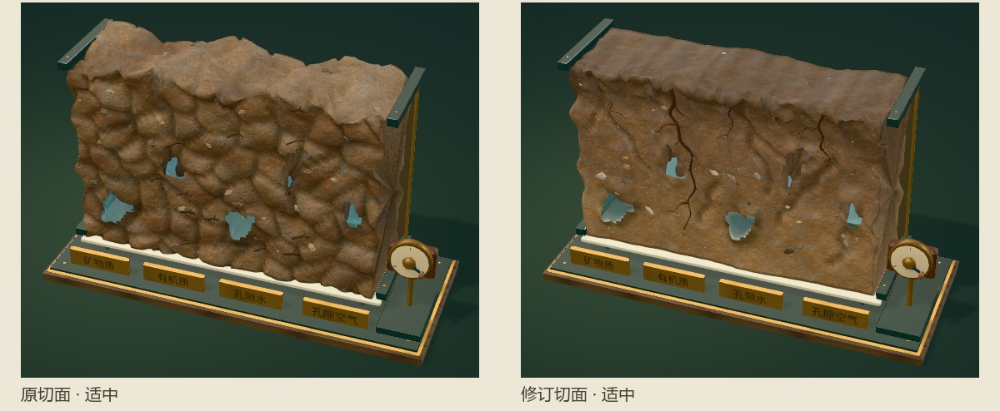
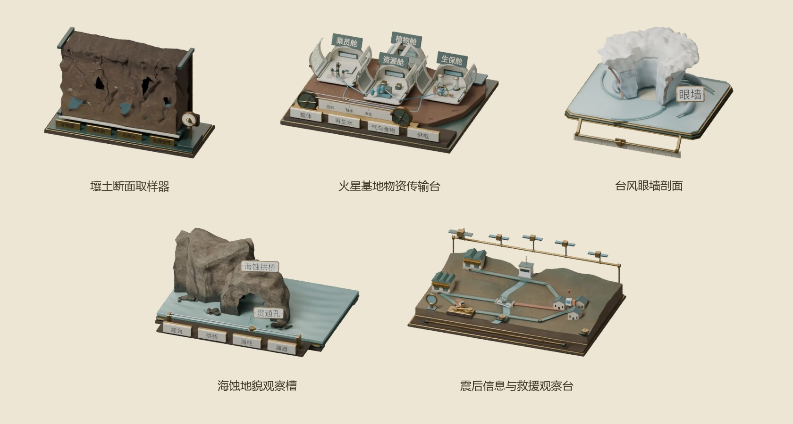

# 自然标本与手动观察仪

生产入口 `index-D8QMHzf5.js`，SHA256 为 `2c062c1e7f4fcdf895a5ae3186602a0300080a5b7c0be7d3e94f0e7c6a3025dc`。本版接续[前一版十件仪器](../visual-XHKEwHac/本版复核.md)。

| 书页 | 在模型上可观察的变化 |
| --- | --- |
| 土壤组成 | 在固定的壤土断口辨认母质颗粒、细砾、腐殖根须和斜裂隙。转动干湿旋钮，水填入同一组孔隙。三档的水量、孔容与界面高度均与改造前一致。 |
| 海岸侵蚀与堆积 | 拱桥和海柱使用裸岩扫描，岩脚有潮湿带和岩屑。拉动前沿铜游标，水面呈现入射和反射。实体拱孔和海柱的轮廓与原模型对应。 |
| 火星基地 | 开合四个舱盖，用四个实体键选择工况。正反摇绳轮使游标沿刻尺追踪净化、储水和回供。三套物资接收刻点沿用原有到达状态。 |
| 台风 | 在 Blender 分层塑造云顶、眼墙和三条雨带，用共用断面保留眼区。握住分度尺前的黄铜把手，依次观察低层辐合、眼墙上升、高空辐散和眼内下沉。进度表示观察次序。原生工程附剖面相机。 |
| 震后协同 | 卫星列与地面沙盘靠近，车辆从库门口出发。桌面鼠标和平板模拟触摸分别选中八处实体并走过 16 种证据组合。在 1024×768 上，地形投影宽从 331 增至 430 像素，车身从 13.5 增至 21.2 像素。 |

暂停时切换需要重新开始的实验会停在新实验起点。显式播放期间切换则继续演示。按住实体手轮或游标时，旁注变化期间保持摄像机位置和方向，松手后恢复书页的取景。震后滑轨在正式入口以鼠标和平板模拟触摸分别从起点拖至 85%，持握期间两次测得的摄像机矩阵变化均为零。

Blender 总装重开检查六章、63 景、6212 个网格。五个修订场景从生产预览采样，再单独渲染五张目录图。对其余 58 景比较网格顶点、索引、物体变换、材质分配和取样状态。总装 SHA256 为 `8ec508268df3f03205f890e013731baa7dee811ed17f3d967582f64364354dcb`。

最终入口通过 TypeScript、628 项单元测试与 12 项端到端测试。手机和平板记录采用浏览器设备模拟。桌面设备在早期集成测验中出现过首次拖距偏差，定位到拖动期间旁注切换引起的镜头重构，已在发布入口验证上述 85% 手势。专项截图与原始数据保存在工作区 `work/next-soil-cut/`、`work/next-sky-bench/`、`work/next-coast-cut/`、`work/next-quake-observer/` 以及 `work/next-manual-selection/`。

