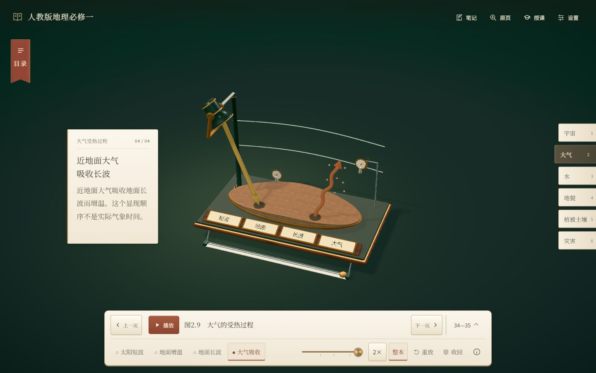
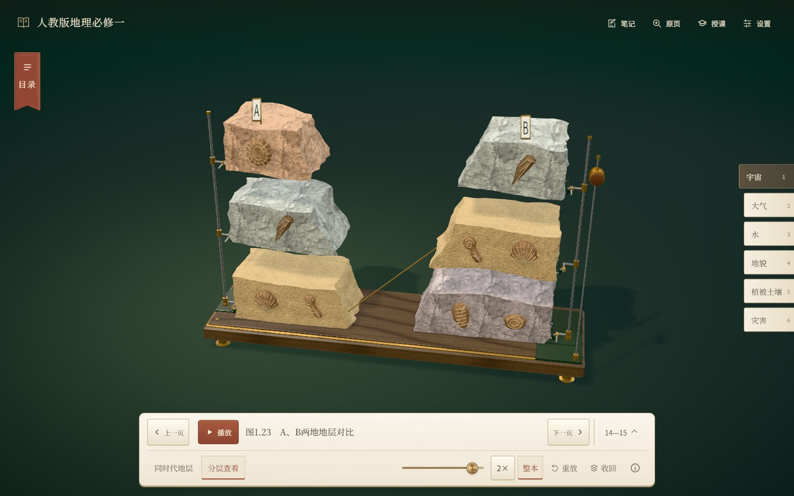
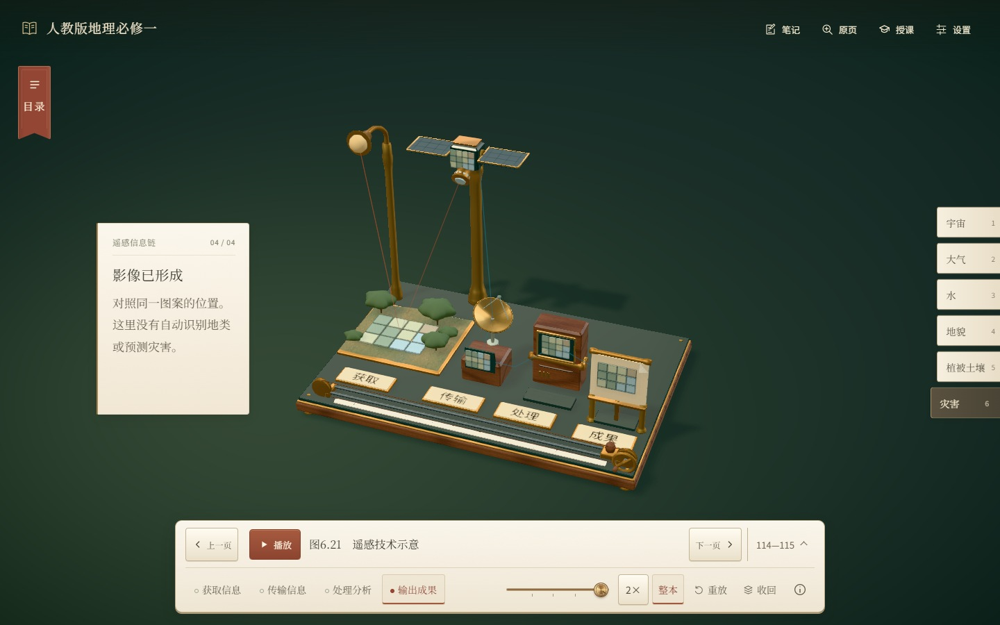

# 七件教具的主体与手动操作

本版包含[上一批手动仪器与材质](../visual-Fj0_kPuZ/本版复核.md)。生产入口为 `assets/index-DlkkfFKV.js`，SHA256 为 `1f449754aec683d7d233ed903fe5d912b99bd1fd3d8500fd4718cbab560d2b0f`。

| 课题 | 仪器上的操作与结果 |
| --- | --- |
| 大气受热 | 推动实验尺或按四个瓷键，经过短波到达、铜皿中土样升温、地面长波及大气吸收。 |
| 大气保温 | 拨动条件盘，在同一时刻更换空框、大气或低云，比较逆辐射与热量读数。 |
| 地球外部圈层 | 推动示踪尺，追踪同三颗水标记经过山脊、河谷、海湾或树根、叶片和大气。 |
| A、B 两地地层对比 | 拉动木柄沿铜导柱分开六块岩样，点选九枚化石之一，检视同类组合在另一岩柱中的位置。 |
| 黄土高原等高线 | 推动观察臂，对比主沟、右支沟的地形和剖面。甲、乙点读数保留教材的 6.4 米高差。 |
| 遥感 | 正反摇动光学台绳轮，追踪十二个地表样本如何经过接收、处理及成像。 |
| 全球卫星导航系统 | 摇动测距仪，检视模型的卫星与接收指示，观察地面监控、用户定位和通信助援。 |

## 合并复核

610 项单元测试、11 项端到端测试及类型检查通过。63 景 Blender 总装重开检查通过，共有 5513 个可编辑网格。七张图录随模型重新渲染。大气组三件独立 Blender 制作工程保留了装配、材质及观察相机。

上一批在 1024×768 的 Edge 平板视口已遍历 63 景。此版对上表七景重测，记录 36 个条件进度和 14 次节点点击，共 50 次，均到达预期状态。三维鼠标、平板或手机模拟的专项记录分别在工作区 `work/three-atmosphere-review/`、`work/manual-coverage/gestures/geology-specimens/` 和 `work/survey-bench-review/`。实体手机手感及整册视觉认可仍待确认。

手机窄屏上的太阳与近邻行星名牌、三角洲给沙提示及雨水标本侧盖文字已重新定位。三页对照检查做了 246 项，同一时刻的名称、读数和操作提示均能分开阅读。

