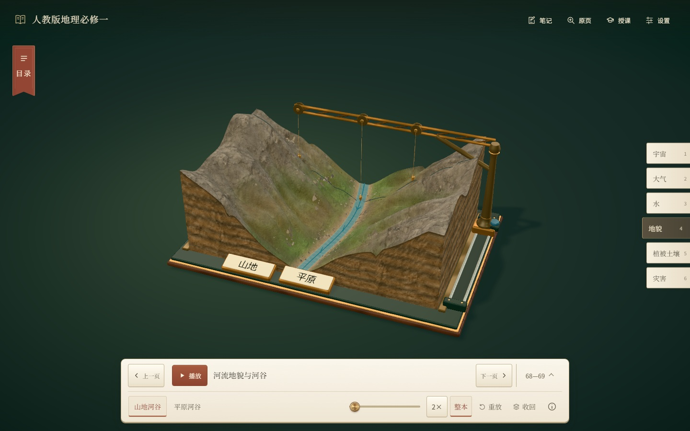
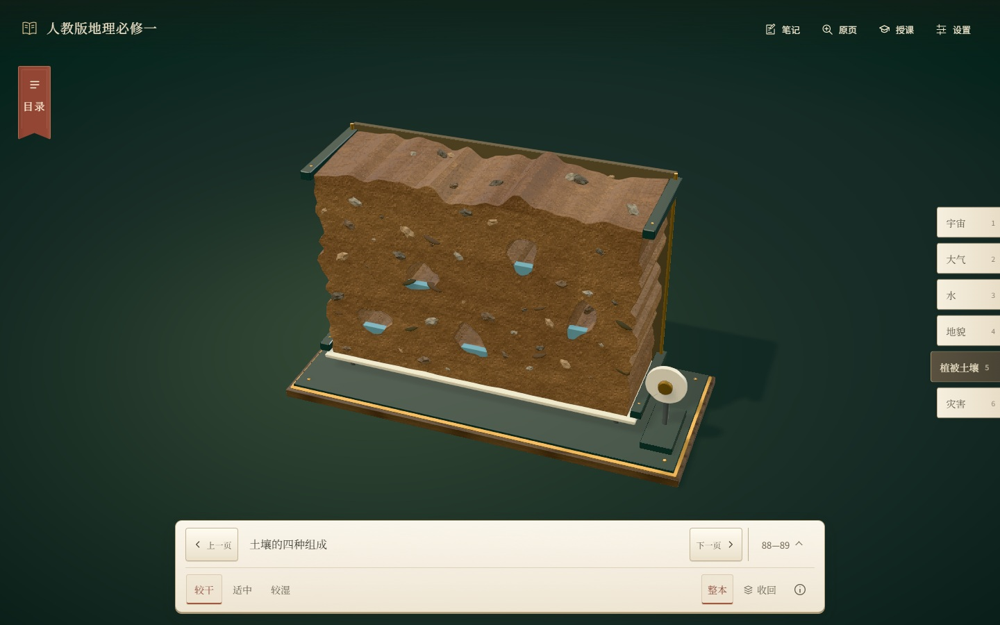
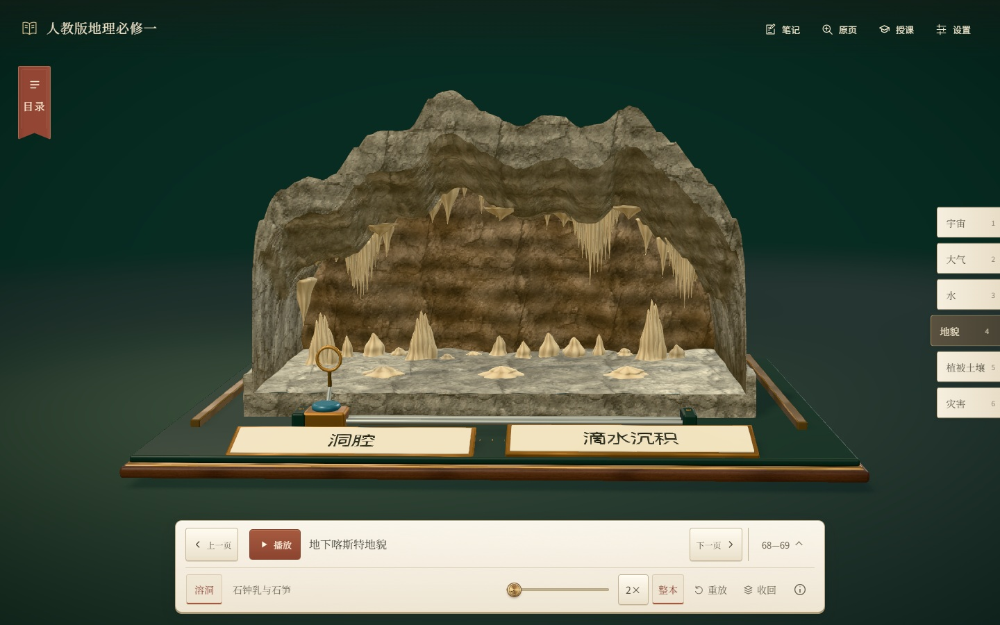
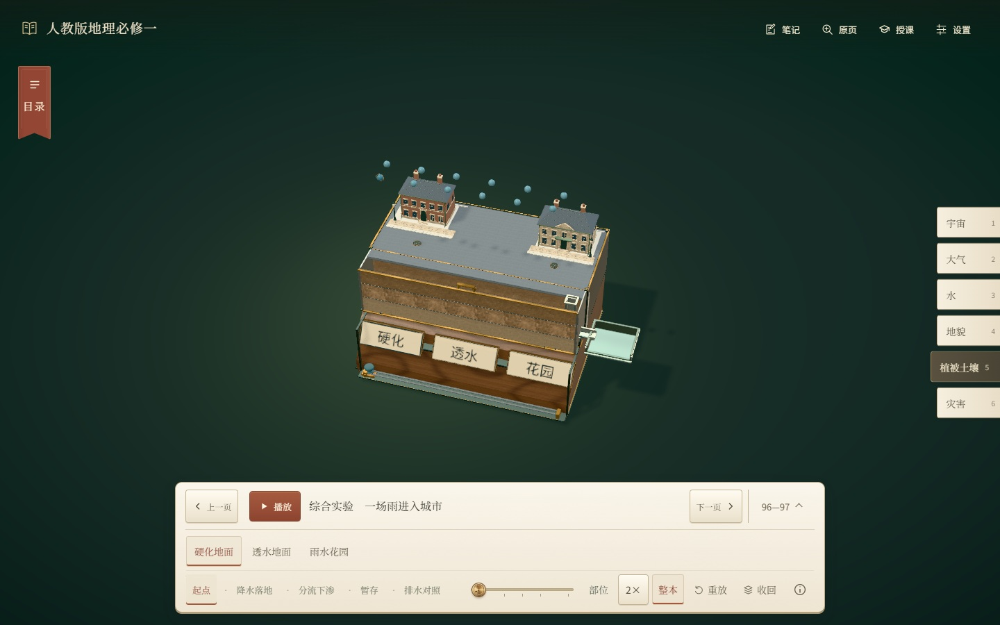

# 手动实验仪器与自然标本

2026-11-20 的生产入口为 `assets/index-Fj0_kPuZ.js`，SHA256 为 `c89418da07b57a1fc08676b36264b70771f5e33b8a71789202d19790a4ceef46`。

| 打开的课题 | 在仪器上可以做什么 |
| --- | --- |
| 太阳系结构 | 正反摇动木柄，观察齿轮带动行星臂。前部分度盘选星，红柄展开传动机构。 |
| 河流地貌与河谷 | 沿右侧导轨推动滑架，比较三只垂锤的高度。两枚瓷键可在同一断面换山地或平原。 |
| 河口三角洲与风沙地貌 | 推动给沙木柄，观察河口沉积。转动风道叶轮，正反查看风沙经过不同标本的结果。 |
| 地下喀斯特与峰丛洼地 | 移动洞前指针观察滴水沉积，在洼地水位标尺上改变位置并切换农林条件。 |
| 土壤组成与成土因素 | 转动干湿旋钮，观察同五处孔隙里的水位。另一个标本可在同一进度用四枚瓷键与换样拉环比较五种因素。 |
| 城市内涝与城市雨水系统 | 推动蓝色滑钮，跟随十二颗水经过屋檐、地面及滤床。保持滑钮位置切换三种地面，综合页的侧盖可以打开检视。 |

木座用了欧洲胡桃木实物扫描。河谷按裸岩、砂砾、草皮及裸土混合表面纹理，分开的剖面仍有层纹。土壤组成页的五孔共处在同一泥土切面，干湿度改变时矿粒固定。五套纹理随网页和离线包分发。

## 本版检查

- 全册为六章、60 景与三个综合扩展。三维和二维均检查了各条件所需的连续操作、独立条件往返与检视返回。登记结果来自可见控制件及状态关系。重点页另做鼠标和模拟触摸实操。
- 平板视口 1024×768 的 Edge 浏览器访问了 63 景，396 次过程采样、193 次节点点击、34 次静态条件采样，共 623 次。运行、资源和节点校验通过。另有 16 页手机二维代表手势检查。触屏数据来自浏览器模拟。
- 网页类型检查、608 项单元测试和 11 项端到端测试通过。总装原生工程重新打开核对了 63 景与 5315 个网格。扫描纹理已打包，河谷的原生单件在第 1、65、111、211 帧另验瓷键、三锤和滑架。
- 八行星、河谷、溶洞在普通动画下均完成展开、手动正反、松手停驻、收回。1366×850、中画质、Intel D3D11 的无头 Edge 中，三景展开帧间隔中位数为 8.3 毫秒。八行星首次展开仍有约 2 秒的单帧停顿。实体设备手感、学校投影和整册审美反馈待补。

## 书页画面

工作区复核明细位于 `work/tablet-branches-Fj0_kPuZ/index.json`、`work/manual-coverage/`、`work/earth-material-review/checks.json`。整册目录制作底稿位于 `release/Blender/catalog/fieldbook.blend`，独立建模及装配见同级“制作素材”目录。
