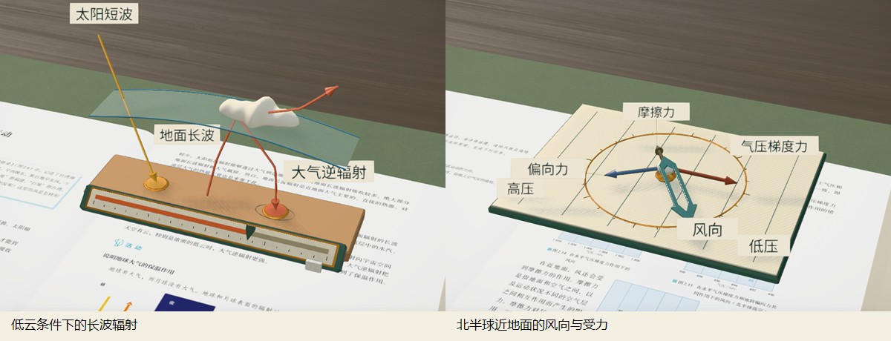

# 大气保温与风向

当前入口 index-Fqn8a841.js。大气保温页在地面放置两个接收位置，分别显示太阳短波、大气向下长波的到达；同一斜面刻尺显示模型的相对地面热状态。三条件分别在 8 个进度样本（含反向回拖）比较二维和三维读数，共 24 对，结果相同。低云使用连续曲面，标注与辐射路径分开排布。

风向页的等压线、黄铜比较环和中心轴共面定位，青色镂空指针表示风向，实心箭头表示各力；四种条件取自同一计算。环上的刻线用于比较方向。二维也复用三维的向量。

两页专项采样 31 个状态和 13 张截图。检查覆盖桌面三维、模拟手机二维。尚待实物平板、课堂投影和最终整册视觉验收。