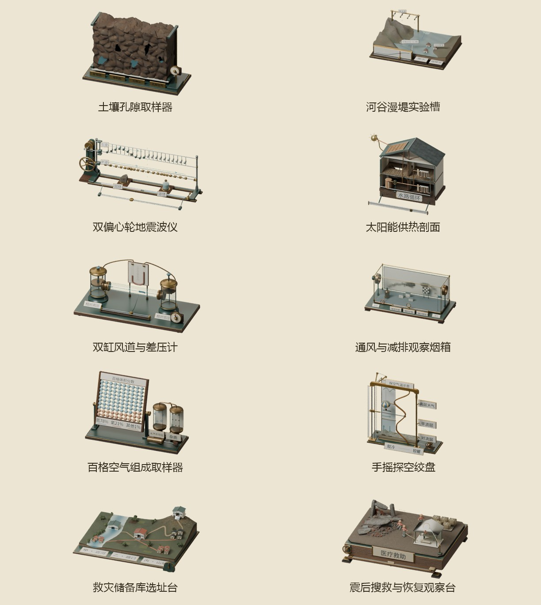

# 十件可以在书页上操作的仪器

本次网页入口为 `assets/index-XHKEwHac.js`，SHA256 为 `fe92048295394a3a567923b103434bcf6faeeaa459c4d0c1671ec35f7eb42edd`。

| 课题 | 手动观察 |
| --- | --- |
| 地震波 | 正反转动曲柄，同时观察两枚偏心销怎样沿相互垂直的滑槽传力。切换岩样和液体瓶，对照纵波与横波的传播。 |
| 太阳能供热 | 用集热器、储罐和两层房间跟随同一组水标记。模型太阳发出三束平行光，板岩瓦下可见木楼梯、楼板开口、屋架和温度计。 |
| 土壤组成 | 转动侧面的三档旋钮，观察一条贯通孔道的五处开窗。三档分别让水占孔道容量的约 16%、50% 和 88%，固定矿物与有机残体留在原处。 |
| 洪涝 | 在同一流域比较降水条件，观察支沟汇流、浮标和房屋进水。漫堤阈值以模型中的刻度表示。 |
| 气压与风、霾 | 在相同气压和有压差之间切换，对照两缸、U 形差压计与风向丝带。在烟箱内分别改变排放和通风，追踪 96 组示踪物。 |
| 空气组成、大气垂直分层 | 百枚算珠组成氮、氧、其余干空气三组，另外抽出水汽和杂质样筒。探空台的绞盘升降吊篮，同时沿气温剖面读取同一高度。 |
| 救灾仓库选址、震后减灾 | 用机械选址器在三处候选地点追踪道路和河谷。转动另一台的观察轮，伸缩读针指向玉树搜救或北川恢复案例中的观察对象。 |

## 实测范围

类型检查、626 项单元测试及 11 项端到端测试通过。生产预览在 1024×768 平板视口核对十景 58 个状态，在 390×844 手机平面模式核对 76 个状态和 310 项检查。鼠标和模拟触摸另外检查了本体调节、回拨、暂停和条件选择。实物触屏手感及整册视觉效果仍待使用者检视。

Blender 总装重新打开核对六章、63 景、6094 个网格。双缸差压计、通风烟箱、百格取样器、手摇探空器另有四份独立 Blender 工程。下图来自本轮总装渲染。

书页截图与数值复核在工作区 `work/tablet-branches-XHKEwHac/`、`work/ten-pages-XHKEwHac-phone.json`、`work/heating-house/`、`work/seismic-eccentrics/`、`work/soil-flood-lab-review/`、`work/pneumatic-review/`、`work/sounding-review/` 及 `work/civil-relief-review/`。