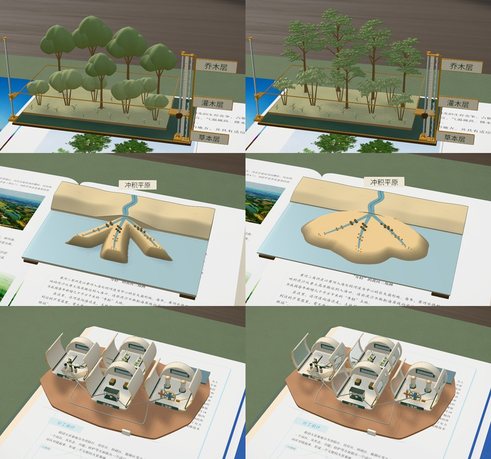

# 森林、三角洲与火星基地

生产入口 `index-imBJeiSr.js`。左栏为上版，右栏为本版，同一桌面视角、同一进度。

森林保留五株乔木、原有灌草与观察尺。每棵乔木沿主干发出分叉枝，叶片沿枝梢成对伸展；前排灌木也采用叶簇。二维在同一株植物上投影各叶簇轮廓。

三角洲的三个分流口共同塑造连续滩地，二维以同一条岸线描绘湿岸和滩顶。颗粒由河道搬运到河口，沉积后留在滩面。以 0.01 的进度增量抽样，空间网格没有出现滩面后退，已停下的颗粒都位于滩顶。两岸仍有规则的模型切边，地形与颗粒均为教学示意。

火星四舱的八扇观察盖嵌入弧形窗。窗洞的内外壁与窗台构成连续剖面，窗面、拉环和纵向铰链随盖联动。此修改只涉及三维观察盖。

本机 Edge 的画面及交互检查覆盖桌面与模拟手机。实物课堂平板、教室投影和整册各分支的最终视觉验收仍待完成。