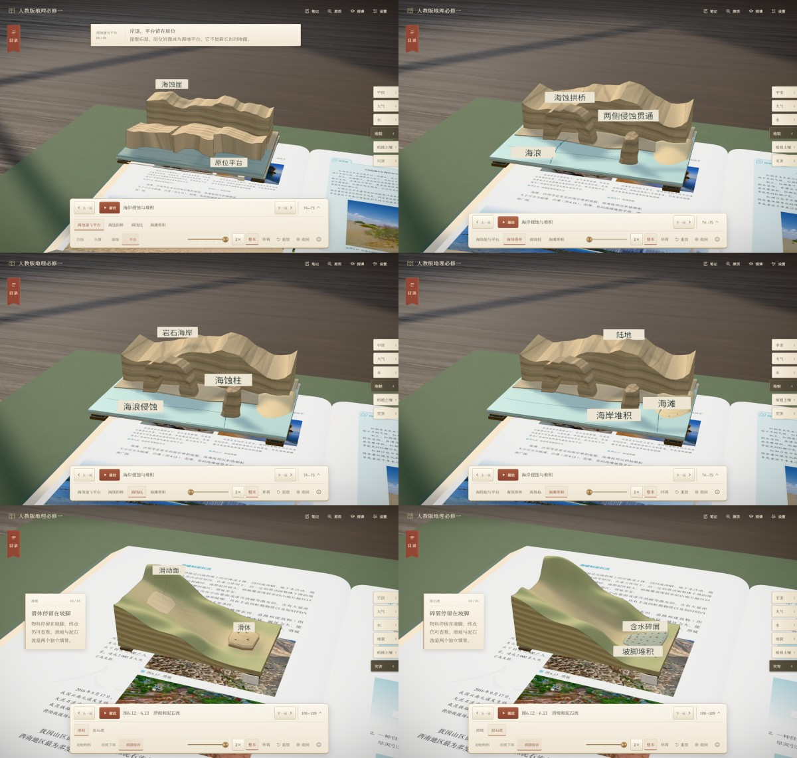

# 海岸与坡地的六个观察条件

同一生产入口 index-rTvcqFJx.js。图上依次为海蚀崖与平台、海蚀拱桥、海蚀柱、海滩、滑坡和泥石流。

海岸标本保留倾斜裂隙和水线，崩块转动时层理跟随岩体。比较条件共享岩岸以便辨认位置关系。海滩位于右岸，在整页尺度下所占面积偏小。滑坡草簇随滑体位移，侧切面显示岩层；泥石流沿沟槽聚到坡脚。滑动面引线从山脊上方的标签落到裸露面。

桌面专项采样分别覆盖海岸 60 个状态和坡地 22 个状态。浏览器未报告页面错误。598 项单元测试通过。全册实物设备验证与审美定稿待完成。
